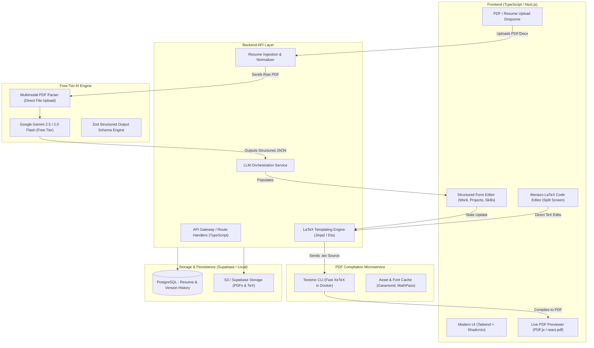

# ResuTex | System Architecture & Tech Stack: AI LaTeX Resume Builder

A production-ready, scalable architecture for an autonomous and interactive **LaTeX Resume Builder** web application with full TypeScript support, free-tier LLM intelligence, PDF ingestion, and instant compilation.

---

## 1. High-Level Architecture Overview



---

## 2. Core Architectural Flow

### A. The "PDF Ingestion & Extraction" Pipeline
Rather than attempting lossy byte-level binary manipulation of compiled PDFs, modern platforms use a **Deconstruct $\rightarrow$ Edit $\rightarrow$ Recompile** pattern:
1. **Upload**: User drops their existing resume (`.pdf`, `.docx`, or `.txt`).
2. **Multimodal LLM Parsing**: The file is sent directly to **Gemini Flash** (which supports native PDF understanding). Gemini extracts every section, bullet point, date, and link into a strict **JSON Resume Schema**.
3. **Template Mapping**: The structured JSON is automatically injected into high-grade LaTeX templates (such as the standard ATS template).
4. **Immediate Compilation**: The compiled PDF is displayed side-by-side with interactive forms.

### B. The "Interactive Customization" Loop
1. **Structured Form Mode**: Non-technical users edit work history, add new bullets, reorder projects, or modify skills using standard UI cards.
2. **Code Mode**: Power users can toggle into a **Monaco Editor** (VS Code in browser) to tweak raw LaTeX macros, fonts, margins, and packages.
3. **AI Enhancement**: A "Polish with AI" or "Tailor for Job Description" button triggers targeted prompt engineering to elevate action verbs and optimize ATS keywords.
4. **Reactive Compilation**: A 500ms debounce sends updated data to the compilation worker, refreshing the PDF viewer instantly.

---

## 3. Recommended Tech Stack Comparison

### Frontend
- **Framework**: **Next.js 15 (App Router)** or **Vite + React 19** with **TypeScript** (Strict mode).
- **Styling**: **Tailwind CSS v4** + **Shadcn/UI** (accessible, customizable Radix primitives).
- **Code Editor**: `@monaco-editor/react` (for the optional raw LaTeX editor tab).
- **PDF Viewing**: `react-pdf` (wrapping PDF.js) with zoom, pan, and text-selection support.
- **State Management**: **Zustand** (lightweight, zero boilerplate, ideal for fast document state and undo/redo history).

### Backend Options & Analysis

| Option | Tech Stack | Strengths | Trade-offs | Recommendation |
| :--- | :--- | :--- | :--- | :--- |
| **Option 1: Full-Stack Next.js (TypeScript)** | Next.js 15 Server Actions + Route Handlers | • Single TypeScript codebase<br>• Zero API contract mismatch<br>• Seamless SSR & Auth | Heavy LaTeX compiler cannot run inside standard serverless limits without Docker | **Best for standard web apps** (with external/containerized compiler) |
| **Option 2: Bun + Hono / Fastify (TypeScript Backend)** | Bun runtime, Hono/Fastify, Dockerized | • Blazing fast cold starts<br>• Native TypeScript execution<br>• Can bundle Tectonic CLI directly into Dockerfile | Need separate frontend & backend deployments | **Best for performance & standalone container** |
| **Option 3: FastAPI (Python Backend) + React** | Python 3.12/3.14, FastAPI, Uvicorn | • Reuses existing `ResumeBuilder` engine directly<br>• Rich data & PDF ecosystem<br>• Native ReportLab / TeX scripts | Polyglot codebase (TS frontend + Python backend) | **Best if reusing your current Python engine** |
| **Option 4: Supabase Backend-as-a-Service** | Supabase (PostgreSQL, Auth, Storage) + Edge Functions | • Complete auth & database out of the box<br>• S3-compatible PDF storage<br>• Generous free tier | Still needs a dedicated Docker worker for LaTeX compilation | **Best BaaS integration** |

---

## 4. LLM Selection: Why Gemini Free Tier is the Winner

| Metric | Anthropic Claude | Google Gemini (Google AI Studio) |
| :--- | :--- | :--- |
| **Free API Tier** | **No** (Prepaid only, requires adding credits) | **Yes** (100% free with no credit card required) |
| **Free Quota** | None | **15 RPM / 1,000,000 TPM / 1,500 RPD** |
| **PDF Input** | Supported via API (paid) | **Native Multimodal PDF Support** (Upload raw PDF up to 2GB) |
| **Structured Output** | JSON mode | **Native `responseSchema` (Zod validation)** |
| **Recommended Model**| Claude 3.5 Sonnet (paid) | **`gemini-2.5-flash`** / **`gemini-2.0-flash`** |

> [!TIP]
> **Gemini Free Tier Strategy**: Use Google's official `@google/genai` SDK in TypeScript. You can upload the candidate's PDF directly to the Gemini File API or send base64 inline, and enforce a strict TypeScript/Zod schema so the LLM returns 100% valid JSON without markdown delimiters.

---

## 5. The LaTeX Compilation Engine Strategy

Running LaTeX in a web app has historically been difficult due to TeX Live's multi-gigabyte footprint. Here is the modern, production-tested solution:

### The Solution: **Tectonic** in a Lightweight Container
- **What is Tectonic?**: An open-source, modernized, self-contained XeTeX engine written in Rust.
- **Why it wins**:
  - Automatically downloads missing packages and fonts on-demand (no need for a 5GB TeX Live install).
  - Single static binary (~30MB).
  - Compiles standard LaTeX documents in **under 1 second**.
  - Docker container size is **under 150MB**.

#### Sample Dockerfile (`Dockerfile.compiler`):
```dockerfile
FROM alpine:edge
RUN apk add --no-cache tectonic font-freefont
WORKDIR /app
COPY templates/ /app/templates/
# Expose HTTP endpoint using a tiny Bun/Node or Go microservice
```

---

## 6. Detailed Data Schema (JSON Resume Standard)

```typescript
// types/resume.ts
import { z } from "zod";

export const ResumeSchema = z.object({
  personal: z.object({
    name: z.string(),
    email: z.string().email(),
    phone: z.string(),
    location: z.string(),
    headline: z.string().optional(),
    portfolio: z.string().url().optional(),
    github: z.string().url().optional(),
    linkedin: z.string().url().optional(),
  }),
  experience: z.array(z.object({
    company: z.string(),
    role: z.string(),
    location: z.string(),
    period: z.string(),
    bullets: z.array(z.string()),
    keywords: z.array(z.string()).optional(),
  })),
  projects: z.array(z.object({
    name: z.string(),
    role: z.string(),
    tech: z.array(z.string()),
    period: z.string().optional(),
    bullets: z.array(z.string()),
  })),
  skills: z.record(z.string(), z.array(z.string())),
  education: z.array(z.object({
    institution: z.string(),
    degree: z.string(),
    period: z.string(),
    highlights: z.array(z.string()).optional(),
  })),
  research: z.array(z.object({
    title: z.string(),
    role: z.string(),
    location: z.string().optional(),
    paper: z.string().optional(),
    description: z.string(),
  })).optional(),
  certifications: z.array(z.object({
    title: z.string(),
    issuer: z.string().optional(),
    date: z.string(),
  })),
  volunteering: z.array(z.object({
    organization: z.string(),
    period: z.string(),
    bullets: z.array(z.string()),
  })).optional(),
});

export type ResumeData = z.infer<typeof ResumeSchema>;
```

---

## 7. Recommended Implementation Roadmap

1. **Phase 1: Ingestion & Parser (TypeScript + Gemini)**
   - Setup Next.js 15 project.
   - Connect `@google/genai` with `GEMINI_API_KEY`.
   - Implement PDF upload endpoint that returns structured `ResumeData`.
2. **Phase 2: Templating & Compilation Service**
   - Package the standard LaTeX template using Eta / Jinja string templating.
   - Run Tectonic via Docker to return compiled PDF buffers.
3. **Phase 3: Interactive UI & Live Preview**
   - Build two-pane view: Left pane has editable section cards (Work history, Projects, Skills) + "Add Work History" button.
   - Right pane displays responsive PDF preview with instant refresh on change.
4. **Phase 4: AI Assistant Features**
   - Add "Bullet Polish": rewrite selected bullet points for stronger impact verbs and metrics.
   - Add "Job Tailor": paste job description to auto-suggest keyword alignment and reorder relevant bullets.
